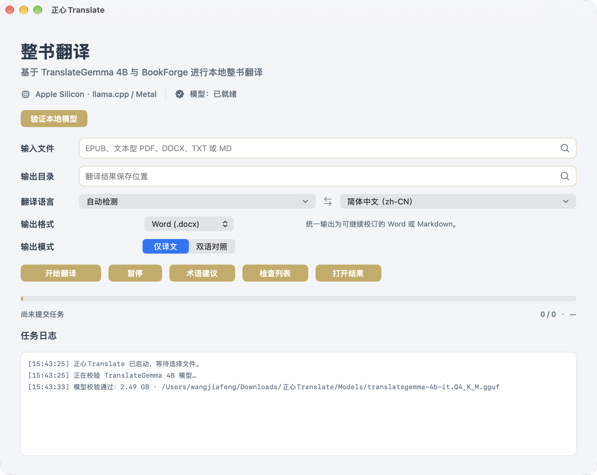

# 正心Translate

正心Translate 是一款在本机运行的文档翻译工具，它由本地 TranslateGemma 模型和 llama.cpp 提供支持，可以进行整本书的翻译。

## 

## 功能

- 支持 EPUB、文本型 PDF、DOCX、TXT 和 Markdown 输入。
- 支持 DOCX 和 Markdown 输出，可选择仅译文或双语对照。
- 支持选择源语言和目标语言、查看术语建议，以及暂停、继续或取消翻译任务。
- 模型推理在本机执行。

## 下载

| 客户端  | 支持范围                                                  | 源码目录   |
| ------- | --------------------------------------------------------- | ---------- |
| macOS   | macOS 14 或更高版本；工程包含 Apple Silicon 与 Intel 架构 | `App/`     |
| Windows | Windows 11 x64                                            | `Windows/` |

请从本项目的 GitHub **Releases** 页面获取 macOS 或 Windows 安装包。

当前构建使用的模型文件名为 `translategemma-4b-it.Q4_K_M.gguf`。发布包不包含 TranslateGemma 模型，首次使用会自动下载 TranslateGemma GGUF 模型，并遵守 [Gemma 使用条款](https://ai.google.dev/gemma/terms)。macOS 客户端会把模型下载到用户目录下的/Library/Application Support/正心Translate/Models/。Windows 首次启动会检查程序旁的 `Models` 目录，并可按程序内流程下载模型。

## 从源码构建

```text
App/       macOS SwiftUI 客户端与 Xcode 工程
Windows/   Windows WPF 客户端、核心代码和构建脚本
Runtime/   macOS arm64 与 x86_64 llama.cpp 运行组件
scripts/   macOS 构建脚本
```

macOS 需要安装 Xcode。打开 `App/正心Translate.xcodeproj`，选择 `正心Translate` scheme 后构建。

也可运行仓库中的 Debug 构建脚本：

```sh
zsh scripts/build.sh
```

该脚本生成本地 Debug 构建，不负责签名、公证或制作发布压缩包。

Windows 需要 Windows 构建环境和 .NET 10 SDK。在 PowerShell 中运行：

```powershell
./Windows/build.ps1
```

脚本先运行核心检查，再发布 win-x64 自包含程序和安装器。

## 第三方组件与许可

本项目源码按 [GNU General Public License v3.0](LICENSE) 授权。

本项目源码的许可不等于第三方组件许可，请同时遵守各组件自己的许可与条款。

llama.cpp 和 BookForge 的许可文件、Gemma 条款声明及其他随组件提供的第三方声明保存在源码对应目录中。使用、修改或再分发第三方组件前，请查看相应声明和上游条款。

